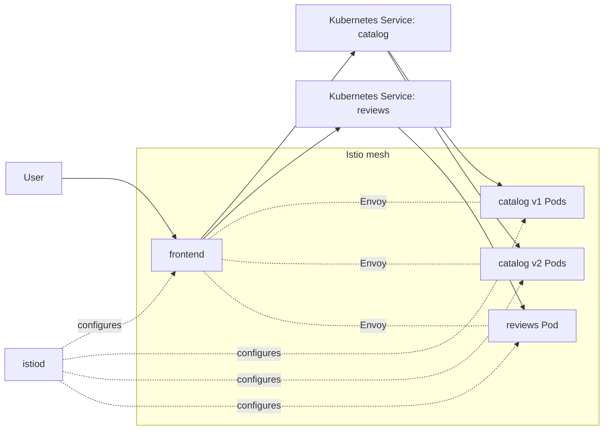

# Istio on KIND: Online Shop Service Mesh Lab

This lab teaches what Istio is, why Kubernetes users add it, and how to demonstrate its features locally.

**Scenario:** an online shop contains a frontend, catalog v1/v2, and reviews. First deploy using Kubernetes Services only. Then install Istio and demonstrate sidecar injection, 80/20 canary traffic, beta-header routing, fault injection, strict mTLS, authorization, and ingress.

## What is Istio?

Istio is a **service mesh**: a layer that manages application traffic between services and provides traffic management, workload security, and telemetry. Kubernetes still schedules Pods, restarts containers, provides Service discovery, and runs cluster networking. Istio does not replace Kubernetes or your CNI.

This repository uses Istio's **sidecar mode**. A participating Pod gets an Envoy `istio-proxy` container beside its application container.

- `istiod` is the control plane. It watches workloads and mesh configuration, then programs proxies.
- Envoy sidecars form the data plane. They intercept and handle application traffic.
- `DestinationRule` defines destination subsets and policies.
- `VirtualService` controls request routing and weights.
- `PeerAuthentication` controls inbound mTLS mode.
- `AuthorizationPolicy` controls which workload identity may do what.
- `Gateway` configures an edge proxy listener; `VirtualService` binds routes to it.

Kubernetes Service DNS continues to work; Istio provides policy-aware traffic control on top.

## Architecture



## Prerequisites and version

Install Docker, KIND, kubectl, curl, Bash, and `istioctl` 1.31.x. On Windows use WSL Ubuntu or Git Bash with Docker Desktop configured. KIND pins Kubernetes node image `kindest/node:v1.35.0`; check the [Istio supported-release matrix](https://istio.io/latest/docs/releases/supported-releases/) before changing versions and use a Kubernetes release supported by your chosen Istio minor.

```bash
docker version
kind version
kubectl version --client
istioctl version --remote=false
curl --version
```

## Repository layout

```text
kind/cluster.yaml
apps/frontend/{Dockerfile,app.py}
base/{namespace,catalog,reviews,frontend}.yaml
istio/{00-demo-gateway,10-catalog-destination-rule,11-catalog-canary-virtual-service,12-catalog-header-route,20-reviews-resilience,30-peer-authentication-strict,31-authorization-policy}.yaml
scripts/{build-and-load,deploy-baseline,install-istio,enable-mesh,test-traffic,cleanup}.sh
```

## 1. Create KIND cluster

```bash
kind create cluster --name istio-lab --config kind/cluster.yaml
kubectl cluster-info --context kind-istio-lab
kubectl get nodes -o wide
```

## 2. Build and load frontend image

```bash
chmod +x scripts/*.sh
./scripts/build-and-load.sh
```

KIND nodes cannot automatically use images from your host Docker cache; the script loads the image into KIND.

## 3. Deploy without Istio (baseline)

```bash
./scripts/deploy-baseline.sh
kubectl -n shop get deploy,pods,svc -o wide
kubectl -n shop port-forward svc/frontend 8080:8080
```

Leave port-forward running. In another terminal:

```bash
curl -s http://localhost:8080/
curl -s http://localhost:8080/call/catalog
curl -s http://localhost:8080/call/reviews
```

The frontend calls `catalog:5678` and `reviews:5678` through Kubernetes Service DNS.

### Show the Kubernetes-only limitation

```bash
kubectl -n shop scale deploy/catalog-v1 --replicas=2
kubectl -n shop scale deploy/catalog-v2 --replicas=2
kubectl -n shop get pods -l app=catalog -L version
for i in {1..12}; do curl -s http://localhost:8080/call/catalog; done
```

The catalog Service selects all Pods labeled `app: catalog`. Kubernetes Services do basic endpoint selection/load balancing; they do not natively express an application-level 80/20 version split or header-based route. That is the policy problem Istio will solve. Stop port-forward with Ctrl+C.

## 4. Install Istio

Install the Istio 1.31.4 CLI from the [official Getting Started guide](https://istio.io/latest/docs/setup/getting-started/), then:

```bash
./scripts/install-istio.sh
kubectl get pods -n istio-system
istioctl version
```

The script uses the `demo` profile for this disposable lab. This profile is for evaluation, not production sizing.

## 5. Enable sidecar injection

```bash
./scripts/enable-mesh.sh
kubectl -n shop get pods
POD=$(kubectl -n shop get pod -l app=frontend -o jsonpath='{.items[0].metadata.name}')
kubectl -n shop get pod "$POD" -o jsonpath='{.spec.containers[*].name}{"\\n"}'
istioctl proxy-status
istioctl proxy-config listeners "$POD" -n shop
```

Expected containers include `frontend` and `istio-proxy`. `istiod` configures proxies; it is not in the request path.

## 6. Canary: 80% v1 and 20% v2

```bash
kubectl apply -f istio/10-catalog-destination-rule.yaml
kubectl apply -f istio/11-catalog-canary-virtual-service.yaml
kubectl -n shop get destinationrule,virtualservice
kubectl -n shop port-forward svc/frontend 8080:8080
```

In another terminal:

```bash
for i in {1..50}; do curl -s http://localhost:8080/call/catalog; done
```

Expect both versions, approximately 80/20 over a sufficiently large sample. Small samples are statistical, not exact counts. `DestinationRule` defines subsets using Pod labels; `VirtualService` chooses subsets and weights. Kubernetes Service discovery remains in place.

Inspect:

```bash
istioctl analyze -n shop
POD=$(kubectl -n shop get pod -l app=frontend -o jsonpath='{.items[0].metadata.name}')
istioctl proxy-config routes "$POD" -n shop
```

## 7. Header-based routing: beta gets v2

```bash
kubectl apply -f istio/12-catalog-header-route.yaml
curl -s http://localhost:8080/call/catalog
curl -s -H 'x-release: beta' http://localhost:8080/call/catalog
```

The `x-release: beta` request goes to v2. Other traffic follows 80/20.

## 8. Timeout, retries, and fault injection

```bash
kubectl apply -f istio/20-reviews-resilience.yaml
for i in {1..30}; do curl -i http://localhost:8080/call/reviews; done
```

Istio injects a 3-second delay into 30% of reviews requests. The frontend's client timeout is 2 seconds, making the delay observable. The VirtualService also declares an Istio timeout and retry policy. Fault injection is a test feature; remove it after the demo:

```bash
kubectl delete -f istio/20-reviews-resilience.yaml
```

## 9. Strict mTLS

Confirm all `shop` workloads have sidecars, then:

```bash
kubectl apply -f istio/30-peer-authentication-strict.yaml
kubectl -n shop get peerauthentication
curl -s http://localhost:8080/call/catalog
curl -s http://localhost:8080/call/reviews
```

Strict mTLS requires encrypted and mutually authenticated connections between participating workloads in this namespace. Envoy proxies use workload identities and certificates provisioned by Istio; application containers do not handle these certificates directly.

Inspect proxy config:

```bash
POD=$(kubectl -n shop get pod -l app=frontend -o jsonpath='{.items[0].metadata.name}')
istioctl proxy-config clusters "$POD" -n shop
```

Do not use an uninjected Pod as the positive test under strict mTLS; plaintext connections should be rejected.

## 10. Authorization policy

```bash
kubectl apply -f istio/31-authorization-policy.yaml
kubectl -n shop get authorizationpolicy
curl -s http://localhost:8080/call/catalog
```

The policy allows the `frontend` service account to issue HTTP GET to catalog. A different workload identity should be denied. mTLS authenticates and encrypts; `AuthorizationPolicy` decides which authenticated identity may perform an operation.

## 11. Optional ingress Gateway

```bash
kubectl apply -f istio/00-demo-gateway.yaml
kubectl -n istio-system port-forward svc/istio-ingressgateway 8081:80
curl -i -H 'Host: shop.local' http://localhost:8081/
```

Gateway configures the edge proxy listener. VirtualService binds `shop.local` and routes ingress traffic to the frontend Service. Gateway alone does not define the application route.

## Troubleshooting

```bash
kubectl get pods -A
kubectl -n shop get pods -o wide
kubectl -n shop describe pod <pod-name>
kubectl -n shop logs <pod-name> -c istio-proxy
istioctl analyze -n shop
istioctl proxy-status
istioctl proxy-config routes <pod-name> -n shop
istioctl proxy-config clusters <pod-name> -n shop
```

| Symptom | Check |
|---|---|
| frontend ImagePullBackOff | Run build-and-load script after KIND creation. |
| Missing istio-proxy | Label namespace and restart Deployments. |
| Wrong route | Check subset labels, hosts, DestinationRule, VirtualService, and `istioctl analyze`. |
| Strict mTLS breaks calls | Ensure caller and target Pods both have sidecars. |
| Gateway 404 | Check Host header, Gateway selector, VirtualService binding, and Service port. |

## Cleanup

Stop port-forward commands, then run:

```bash
./scripts/cleanup.sh
```

This deletes the KIND cluster and all resources inside it.

## Suggested 10-minute teaching flow

1. Minutes 0–2: baseline Kubernetes Service calls.
2. Minutes 2–4: install Istio, inject and inspect `istio-proxy`.
3. Minutes 4–6: 80/20 canary and beta header route.
4. Minutes 6–8: latency/fault injection and retries.
5. Minutes 8–10: strict mTLS and authorization.

**One-line explanation:** Kubernetes runs and connects services; Istio adds a programmable, observable, and secure traffic layer between services.

## Official references

- [Istio architecture](https://istio.io/latest/docs/ops/deployment/architecture/)
- [Istio Getting Started](https://istio.io/latest/docs/setup/getting-started/)
- [Traffic Management](https://istio.io/latest/docs/concepts/traffic-management/)
- [Security concepts](https://istio.io/latest/docs/concepts/security/)
- [Supported releases](https://istio.io/latest/docs/releases/supported-releases/)
- [KIND Quick Start](https://kind.sigs.k8s.io/docs/user/quick-start/)
